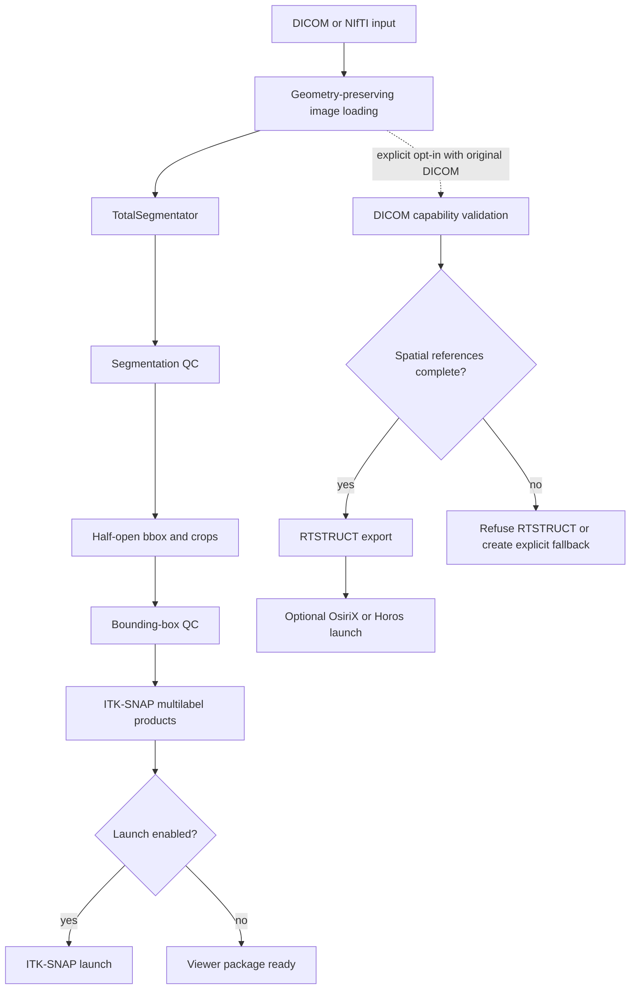

# Architecture

## Primary and optional branches

The solid branch is the supported v1.1 interactive workflow. The dotted DICOM
branch is optional and never runs silently during `run-all`.

## Coordinate conventions

- SimpleITK indices, sizes, spacing, and origins use `x,y,z`.
- Arrays returned by SimpleITK use NumPy `z,y,x` order.
- Physical points are millimeters in the image coordinate frame.
- Direction matrices are preserved; identity direction is never assumed.
- Bboxes use half-open NumPy intervals `[min:max)`.
- Crops use SimpleITK regions, retaining spacing/direction and updating origin.

## Semantic labels

MRI viewer mapping:

| Value | Meaning |
|---:|---|
| 0 | Clear Label / background |
| 1 | Lung Left |
| 2 | Lung Right |
| 10 | Lung Bounding Box |

Anatomical sides come from TotalSegmentator semantic filenames, never coordinate
sign or screen position. CT's five lobe masks are processed by the segmentation
stage, but their ITK-SNAP label mapping is not configured in v1.1.

## Six-face bbox shell

For `[z0:z1, y0:y1, x0:x1)`, the authoritative bbox label marks faces at `z0`,
`z1-1`, `y0`, `y1-1`, `x0`, and `x1-1`, filling across the other dimensions.
This remains valid at image boundaries and for one-voxel dimensions. In the
combined viewer image, bbox label 10 has display priority over lung labels. The
separate lung and bbox products remain authoritative.

## Geometry validation

All full-volume masks and viewer labels must match reference size, spacing,
origin, and direction. Binary anatomical masks must be nonempty and disjoint.
Viewer images use an unsigned integer label type and copy reference metadata.

## Resume logic

Earlier stages reuse their required outputs only when complete. ITK-SNAP reuse
requires all five package files plus a manifest with:

- completion status `complete`;
- matching safe source-image path;
- matching size, spacing, origin, and direction;
- the v1.1 label mapping;
- a half-open `z,y,x`, `max-1` bbox convention.

Partial, malformed, stale, or semantically incompatible packages are regenerated
only within the selected case's ITK-SNAP output directory.

## Privacy boundaries

Private inputs live under ignored `data/raw/`; all generated artifacts live under
ignored `outputs/`. Safe summaries omit identifying DICOM tags and use
project-relative paths when possible. The optional DICOM validator reads only
the structural metadata required for capability classification. Pipeline logs do
not store environment variables or full subprocess output.

## Optional RTSTRUCT branch

RTSTRUCT export requires consistent Study/Series identifiers, unique SOP
Instance UIDs, dimensions, pixel spacing, orientation, positions, one-to-one
slice mapping, and `FrameOfReferenceUID`. Missing reference metadata does not
affect NIfTI processing or ITK-SNAP visualization.
