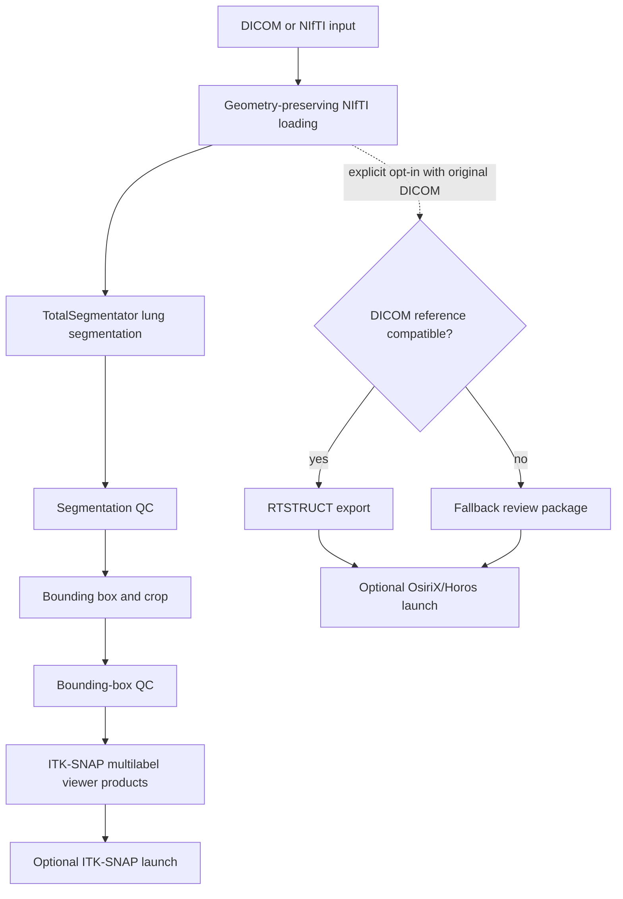

# Architecture

## Data Flow

## Coordinate Conventions

- SimpleITK indices and image size use `x, y, z`.
- NumPy arrays from SimpleITK use `z, y, x`.
- Physical coordinates are millimeters in the image coordinate frame.
- Bounding boxes are stored as half-open intervals `[min:max)` in NumPy
  `z, y, x` order.

## Geometry Preservation

Images, masks, crops, and overlays are validated with size, spacing, origin, and
direction checks. Crops use SimpleITK region-of-interest operations so the crop
origin is updated to the physical location of the crop start index.

## Viewer Products

The primary interactive-review branch creates geometry-matched integer NIfTI
labels for semantic lungs, a six-face half-open bbox shell, and a combined
viewer segmentation. ITK-SNAP launch is optional and uses the full image, the
combined segmentation, and its label-description file.

## Optional DICOM Export

The explicit OsiriX export command validates structural DICOM references before writing a
referenced RT Structure Set. It refuses to fabricate missing Frame of Reference
or slice-reference metadata. If a referenced object cannot be guaranteed, it
creates a fallback review package instead.
